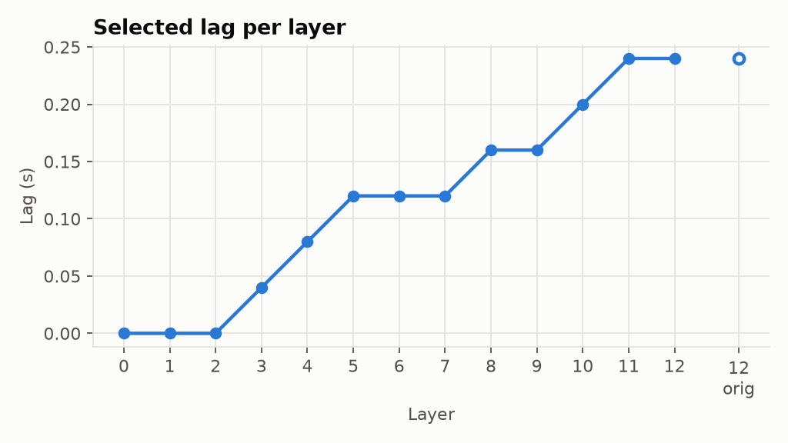
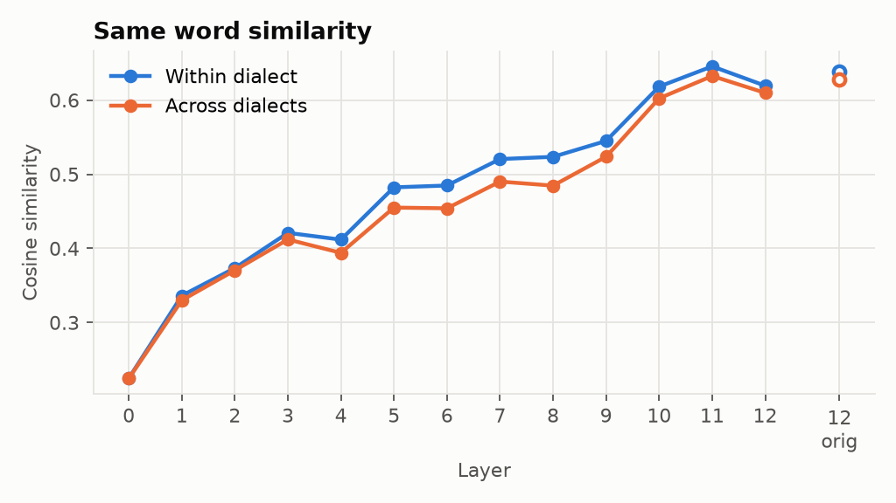
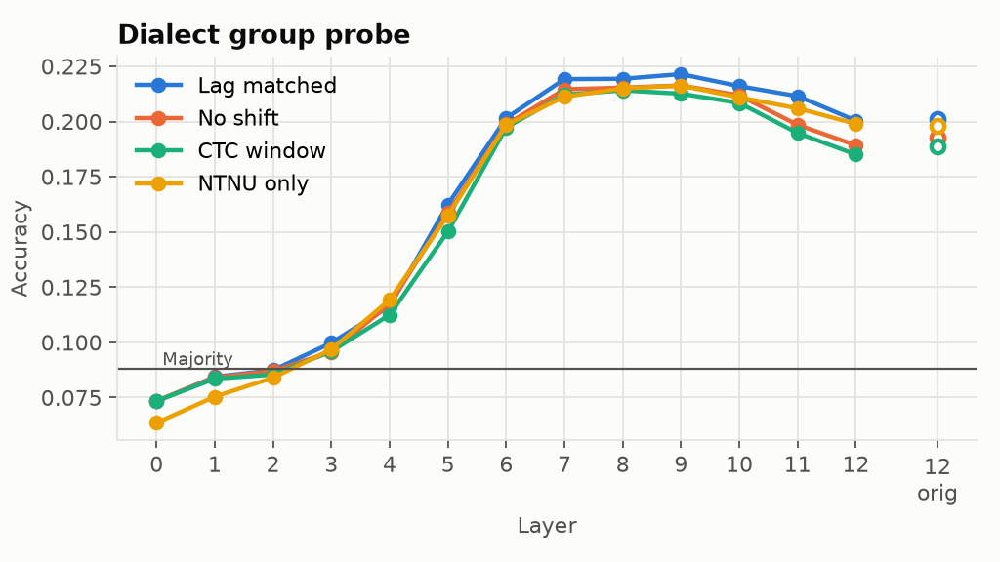
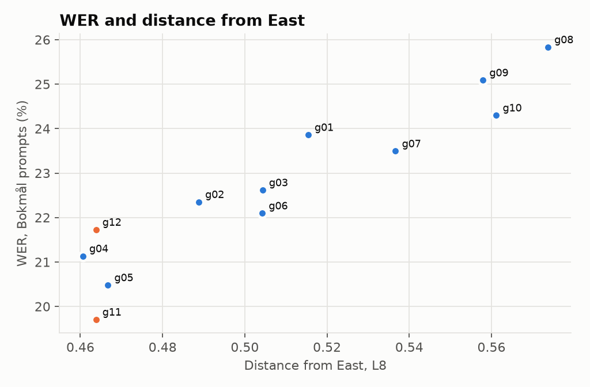
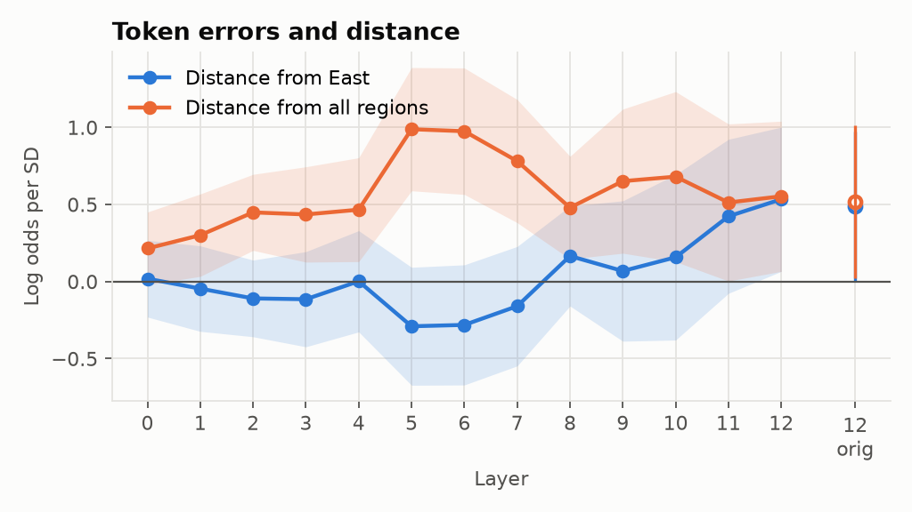
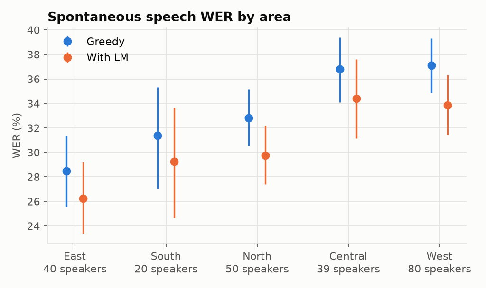

# norsk-dialect-probing

**TL;DR:** A Norwegian speech model makes about 30% more errors on spontaneous speech from Western Norway than from
Eastern Norway. Its encoder represents the same word almost equally across dialects, so the errors likely come from
writing dialect speech as Bokmål. More dialect training data may help (untested).

Does the audio encoder of a Norwegian speech recognizer map different dialect pronunciations of the
same word to similar internal representations (convergence), or do representations stay clustered
by dialect?

The model is [norsk-asr](https://github.com/ahdrage/norsk-asr) ([weights](https://huggingface.co/ahdrage/norsk-asr)):
the 12-layer audio encoder of [EmbeddingGemma 2](https://huggingface.co/google/embeddinggemma-2) with
only the top layer fine-tuned, a learned softmax mix over its 13 hidden states, and a 6-layer
conformer reader trained with CTC over 83 characters. Layers 1-11 are Google's original weights, so
we can look at an encoder that never saw Norwegian ASR training (layers 1-11, and layer 12 as
released by Google) next to the one layer that did.

The data is [NB Tale](https://hdl.handle.net/21.11146/31) (Språkbanken, CC0): read speech from
12 dialect regions, 20 native speakers each, plus 20 native speakers of mixed origin. Every speaker
reads 3 shared calibration sentences (set A), 12 sentences shared with two other speakers (set B)
and 5 unique sentences (set C).

## Related work

Parsons et al. (2023), "A character-based analysis of impacts of dialects on end-to-end Norwegian
ASR" (NoDaLiDa), analyse the *output* errors of Norwegian ASR on NB Tale by dialect region. Here we
look *inside* the model: where in the encoder dialect information lives, and whether it fades.

## Results

**Read speech** (NB Tale modules 1-2, 130 + 120 speakers). The full write-up is in [`results/summary.md`](results/summary.md).

- **Convergence is only partial.** The same word is nearly as similar across dialects as within one (across / within ≥ 0.92 at every layer). The dialect gap peaks in the middle of the encoder (L8) and shrinks toward the top. Fine-tuning L12 changed none of this.
- **Dialect is decodable from single words** from L5 upward: about 0.22 accuracy for 12 groups, against a 0.09 majority baseline.
- **Region-level WER tracks distance from East** (Spearman 0.94 at L8), **but the link disappears at the token level.** Errors follow how atypical a token is in general, not its distance from Eastern pronunciation. The region-level correlation is not evidence of an Eastern bias.
- **The layers where dialect peaks (L7-L9) are redundant in the mix.** Removing them leaves WER unchanged in every region.







**Spontaneous speech** (NB Tale module 3, 249 native speakers, norsk-asr only). The analysis plan was fixed before decoding.

- **West WER is 37.1% against 28.5% East** (greedy): +8.6 points, +30% relative, 95% CI over speakers [+16%, +47%]. The misheard-word gap is +5.6 points, CI [+3.3, +7.7].
- This meets the threshold for a meaningful gap set before decoding, so **H1 is supported for norsk-asr**.
- **Central Norway (Trøndelag, Helgeland) is as high as West**, so the gap is East vs the rest rather than West in particular.
- **The language model lowers every area but leaves the gap** (+7.6 points).
- **Read speech showed a smaller gap**, about +16% relative with the same model.



NB Samtale was decoded as a second set, but after the Bokmål filter it has only 3 West speakers, so its West-East
comparison says little (+0.3 points, CI spanning zero). Comparisons with NB-Whisper and nb-wav2vec2, and a dialect-balanced
retraining experiment, were planned but not run on this machine.

## Setup

```bash
git clone https://github.com/ahdrage/norsk-asr.git ../norsk-asr
uv sync
uv run python scripts/fetch_checkpoint.py
```

norsk-asr is imported from the clone, never copied. The EmbeddingGemma 2 encoder (1.5 GB) is
downloaded from the Hub on first use. Paths and subset size are in [`config.yaml`](config.yaml).

## Steps

| Script | What |
|---|---|
| `scripts/00_check_env.py` | GPU visible to torch; fp32 / bf16 matmul sanity |
| `scripts/01_layer_weights.py` | learned layer-mix weights from the checkpoint |
| `scripts/03a_nbtale_metadata.py` | speaker, utterance and word tables; speakers per group; words shared across groups; written standard per sentence |
| `scripts/03b_ctc_align.py` | greedy transcripts and CTC forced alignment with the model's own head; compared with the manual word boundaries |
| `scripts/03c_check_timebase.py` | manual timings vs. audio: sample rates, durations, speech onset |
| `scripts/04_extract.py` | word-pooled encoder activations for all 13 hidden states and the original layer 12 |
| `scripts/04b_lag_sweep.py` | same-word similarity as the pooling window is shifted later |
| `scripts/05a_select_lag.py` | split speakers in half; pick each layer's lag on one half with a word identity probe |
| `scripts/05b_convergence.py` | within vs across dialect similarity of the same word, permutation test, controls and strata |
| `scripts/05c_dialect_probe.py` | 12-way dialect group probe on word tokens |
| `scripts/05d_wer_distance.py` | error rates per group; correlation with representational distance from East |
| `scripts/05f_word_errors.py` | per-token distance from the Eastern and overall word centroids vs recognition errors; layer-mix weights vs dialect signal |
| `scripts/05g_mix_ablation.py` | greedy WER per region with layer-mix weights reduced |
| `scripts/05e_plots.py` | figures in `results/` (run last) |
| `scripts/08a_spont_data.py` | spontaneous segments: NB Tale module 3 cut at sentence boundaries (≤ 30 s), NB Samtale Bokmål segments |
| `scripts/08b_decode.py` | norsk-asr greedy and 4-gram LM transcripts of all segments |
| `scripts/08c_score.py` | WER, CER and misheard-word rate per area with speaker bootstrap CIs; West-East gap; contamination checks |
| `scripts/08d_plots.py` | spontaneous WER figure |

Scripts that read downloaded data are run with `python -I`.

## Data

NB Tale is downloaded from Språkbanken (`https://www.nb.no/sbfil/talegjenkjenning/lingit/`):
`Annotation.zip`, `Documentation.zip` and the headset recordings `sennheiser_1.tar.gz` (module 1)
and `sennheiser_2.tar.gz` (module 2), unpacked under `data/nbtale/raw`. Only native speakers are
used: groups 1-12 (one dialect region each) and group 24 (mixed regions, left out of dialect
comparisons). Utterances whose prompt contains digits are skipped, as in norsk-asr's training.
The spontaneous follow-up adds module 3 (`sennheiser_3.tar.gz`, 3.3 GB) and the Bokmål segments of
[NB Samtale](https://huggingface.co/datasets/Sprakbanken/nb_samtale) under `data/nb_samtale`.

Each sentence is tagged Bokmål, Nynorsk or unclear by counting words that exist in only one of the
two Norsk ordbank full-form lists (`https://www.nb.no/sbfil/leksikalske_databaser/ordbank/`,
`20220201_norsk_ordbank_nob_2005.tar.gz` and `20220201_norsk_ordbank_nno_2012.tar.gz`, unpacked
under `data/ordbank`). norsk-asr writes Bokmål only, so error rates are reported per written standard.

## Word windows

The encoder runs at 25 frames/s; frame *j* is centred at 0.04·*j* s. Two kinds of word windows are
used:

- **manual**: NB Tale's hand-segmented word boundaries (frames whose centre falls inside the word);
- **CTC**: the model's own forced alignment, shifted back by the median lag against the manual
  boundaries (4 frames).

Raw CTC spans start about 0.22 s after the word, and deeper layers carry a word later than shallow
ones (`04b_lag_sweep.py`), so the manual window is also shifted later in 0.04 s steps.

## Outputs

`outputs/activations/`:

| File | Shape | What |
|---|---|---|
| `words.parquet` | one row per word | word, speaker, group, region, sentence set, written standard, manual and CTC times and frame windows; row *i* matches index *i* of the arrays |
| `manual.npy` | words × 14 × 1024, float32 | mean over the manual window of each hidden state |
| `ctc_shifted.npy` | words × 14 × 1024, float32 | the same over the shifted CTC window |
| `lag_sweep.npy` | words × 14 × 11 × 1024, float16 | per-frame layer-normed states, averaged over the manual window shifted later by 0-10 frames |
| `ctc_shifted_ln.npy` | words × 14 × 1024, float16 | per-frame layer-normed states over the shifted CTC window |
| `meta.json` | | layer names and versions, frame length, CTC lag, sweep layers and shifts |

The 14 layers are the 13 hidden states of the released model (`L0` is the input after subsampling,
`L1`-`L12` the conformer layers; version `finetuned`) and Google's original layer 12 (`L12_orig`,
version `original`). Layers 0-11 are identical in both models.

`outputs/align/` holds the greedy transcripts and per-word alignments. `outputs/step5/` holds the
speaker split, selected lags and the tables behind the figures.
