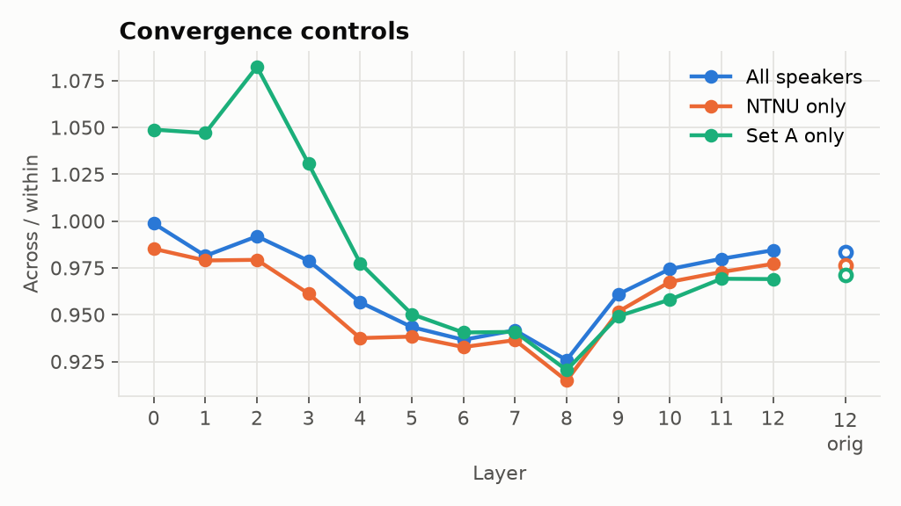
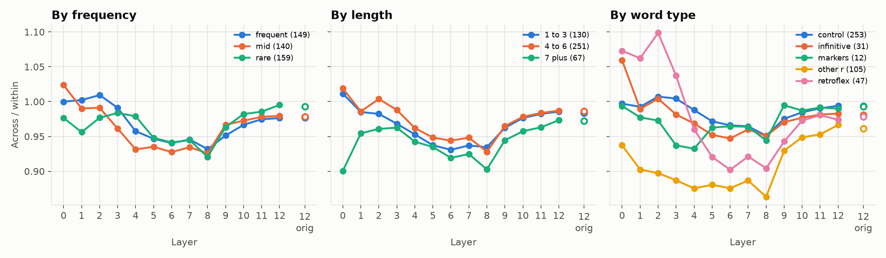
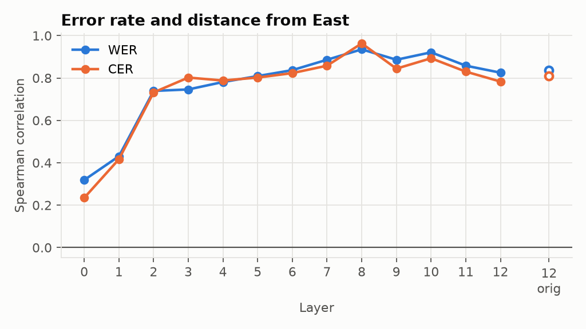
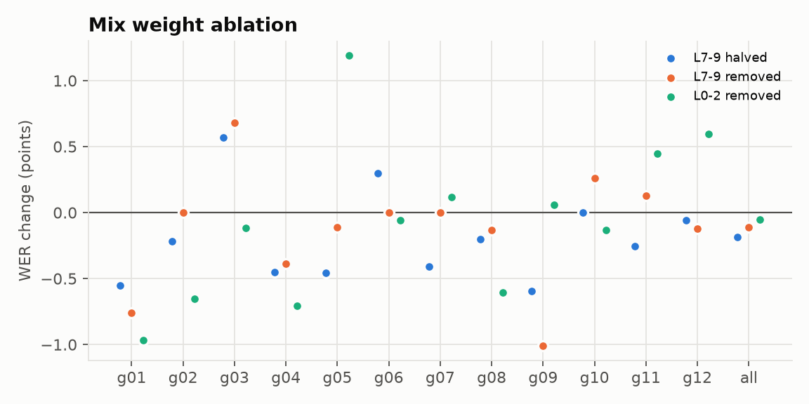

# Step 5 findings

## Conclusion (read speech)

- **Token-level errors come from general atypicality, not distance from East.** A token far from the typical pronunciation of its word is more likely to be misrecognized. Being far from the Eastern pronunciation in particular adds nothing, at least up to L10.
- **The region-level correlation does not hold at token level.** Across the 12 regions, distance from East correlates with Bokmål WER (Spearman 0.94 at L8), but this pattern disappears for individual tokens. It should not be read as evidence that the model is biased toward Eastern speech. Regions with more distinct dialects also have more atypical tokens overall, and regions differ in other ways too.
- **L7-L9 are redundant in the layer mix.** The dialect signal peaks in these layers, but removing them from the mix leaves WER unchanged in every region.
- **The encoder's representations converge across dialects only partly.** The same word is nearly as similar across dialects as within one (across/within ≥ 0.92). Upper layers converge more than middle ones. Fine-tuning L12 changed none of this.
- **Dialect has a small effect on read speech.** Bokmål WER ranges from 19.7% (g11) to 25.8% (g08).

Speakers in groups 1-12 are split in half within each group and gender. The selection half (130
speakers) picks a pooling lag per layer; every number below is from the other half (120 speakers in
groups 1-12, 26,272 word tokens, 448 word types read in at least 3 groups). Same-speaker and
same-sentence pairs are excluded. Main windows are the manual word boundaries shifted by the
selected lag; unshifted manual and shifted CTC windows are robustness checks.

## Lag per layer

The lag is chosen by a word identity probe (118 words, 2 speaker folds), not by any dialect contrast.
It grows with depth: 0 s up to L2, 0.12 s at L5-L7, 0.24 s at L11-L12. Without the shift, word
identity accuracy at L12 falls from 0.95 to 0.68, so layer-matched windows matter.

## Convergence

 

Same-word similarity across dialect groups stays close to similarity within a group at every layer
(across / within ≥ 0.92). The dialect gap is not significant up to L3, grows through the middle
layers, peaks at L8 (ratio 0.926, gap 0.039, speaker-permutation p ≤ 0.01) and shrinks toward the
top (L12 0.984, still p ≤ 0.01). Upper layers partly converge, but they don't fully converge.
The same shape holds with NTNU recordings only, on set A sentences only (identical text for all
speakers), and with unshifted or CTC windows.

| Layer | Within | Across | Ratio | Dialect probe |
|---|---|---|---|---|
| L0 | 0.225 | 0.225 | 0.999 | 0.073 |
| L4 | 0.412 | 0.394 | 0.957 | 0.116 |
| L8 | 0.523 | 0.485 | 0.926 | 0.219 |
| L12 | 0.619 | 0.610 | 0.984 | 0.200 |
| L12 orig | 0.638 | 0.627 | 0.983 | 0.201 |

## Dialect probe

A 12-way linear probe on single word tokens (5 speaker folds) is at or below the majority baseline
(0.088) up to L2. It rises to 0.22 at L7-L9 and drops slightly to 0.20 at L12. It is
not explained by recording place: with NTNU speakers only it reaches 0.216.

## Strata

- **Frequency:** no consistent effect.
- **Length:** words of 7+ letters diverge more at every layer.
- **Words with r but no r+consonant cluster:** these show the largest dialect gap at all layers, including L0 (ratio 0.86-0.94). This fits the tapped vs uvular r split.
- **Retroflex contexts:** close to no gap early, then a clear dip at L5-L8 (0.90).
- **Pronoun and negation markers:** only 12 types; they behave like controls.
- **Infinitive class:** it holds words like *dette*, *bare*, *neste* that are rarely used as infinitives, so it is not a clean test of -a/-e endings.

## Error rate and distance from East

 

Distance from East is 1 minus the mean same-word similarity to groups g11 and g12. Across the 12 groups it tracks
greedy Bokmål WER from L2 upward, strongest at L8 (Spearman 0.94, permutation p < 0.001). Leaving
out g11 and g12 themselves, which are near by construction, it still holds (n = 10, ρ = 0.95 at L8).
g08 (Rogaland and Hordaland) is recorded entirely at NTNU and has both the largest distance and the
highest WER, so recording place does not drive this.

## Original vs fine-tuned layer 12

Fine-tuning only L12 left it nearly unchanged on every measure:

| Measure | Fine-tuned | Original |
|---|---|---|
| Selected lag | 0.24 s | 0.24 s |
| Word probe | 0.949 | 0.949 |
| Across / within ratio | 0.984 | 0.983 |
| Dialect probe | 0.200 | 0.201 |
| WER correlation (ρ) | 0.83 | 0.84 |

The partial convergence at the top is already in Google's encoder. Fine-tuning did not add it.

## Word-level errors (5f)

**Setup:**
- Tokens: analysis half, Bokmål prompts. A token counts as an error if it is not matched in the greedy transcript.
- Each token gets two distances:
  - from the Eastern (g11, g12) centroid of its word type;
  - from the centroid of its word type over all regions.
- Both centroids leave out the token's own speaker.
- The Eastern centroid needs at least 2 other Eastern speakers.
- Only word types with both correct and wrong tokens are kept: 8,004 tokens, 121 types, token error rate 0.20.
- Model: logistic regression with both distances (standardized), plus word-type and speaker fixed effects. Word type absorbs word length. Standard errors are clustered by speaker.

**Results:**
- Distance from all regions predicts errors at every layer from L1. It is strongest at L5-L6 (+0.99 log odds per SD, p < 1e-5).
- Distance from East adds nothing beyond it in L0-L10. At L8 it is +0.17 (p 0.32).
- Only at L11-L12 does it add a little: +0.53 at L12 (p 0.03; without Eastern speakers +0.47, p 0.09).
- Within word types, error tokens are not further from East than correct tokens once overall distance is regressed out: 57% of 80 types at L8.
- The two distances correlate 0.92-0.98, so the test has limited power to separate them.
- Without the control, distance from East alone does predict errors (+0.62 at L8). That effect is carried by a token being atypical in general.

The region-level link between WER and distance from East is therefore not visible token by token. Within a word type, a token that is far from the East is no more likely to be misrecognized than an equally atypical token in any other direction.

## Layer mix and ablation

| Layer | Mix weight | Dialect probe | Gap |
|---|---|---|---|
| L0 | 0.092 | 0.073 | 0.000 |
| L5 | 0.215 | 0.162 | 0.027 |
| L6 | 0.166 | 0.202 | 0.031 |
| L7 | 0.085 | 0.219 | 0.030 |
| L8 | 0.042 | 0.219 | 0.039 |
| L9 | 0.043 | 0.221 | 0.021 |
| L12 | 0.147 | 0.200 | 0.010 |

The mix favours L5-L6 and L12. L7-L9, where the dialect signal peaks, together get 0.17 (uniform would be 0.23). L5-L6 carry nearly as much dialect information.

Exploratory ablation:
- Setup: greedy decoding of the analysis half (2,068 utterances) with L7-L9 halved or removed and the rest renormalized. A control removes L0-L2 instead, a similar 0.19 of the weight.
- Overall Bokmål WER: 23.69% baseline, 23.50% with L7-L9 halved, 23.58% removed, 23.64% for the control. There is no cost, and also no gain.
- Per region the changes are all within about ±1 point, about the noise level for roughly 170 utterances per region.
- The changes are not related to distance from East (Spearman 0.06, -0.02, -0.23).
- Removing L7-L9 does not remove the dialect information, because L5-L6 and L12 carry much of the same signal. So this is weak causal evidence either way.

## Caveats

- NB Tale modules 1-2 are read speech. Module 3 (spontaneous speech) is a planned follow-up.
- WER and CER are greedy without a language model, and only Bokmål prompts are used. Nynorsk prompts have about 50% WER for every group, because the model only writes Bokmål.
- 12 groups is a small n for the correlation. Groups g01-g04, g07, g09 and g10 include speakers recorded at UiT or UiA.
- With 100 permutations, p cannot go below 0.01.
