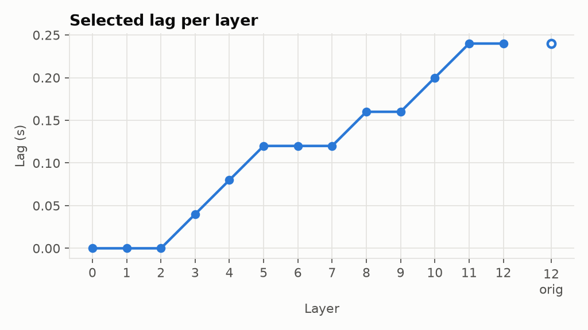
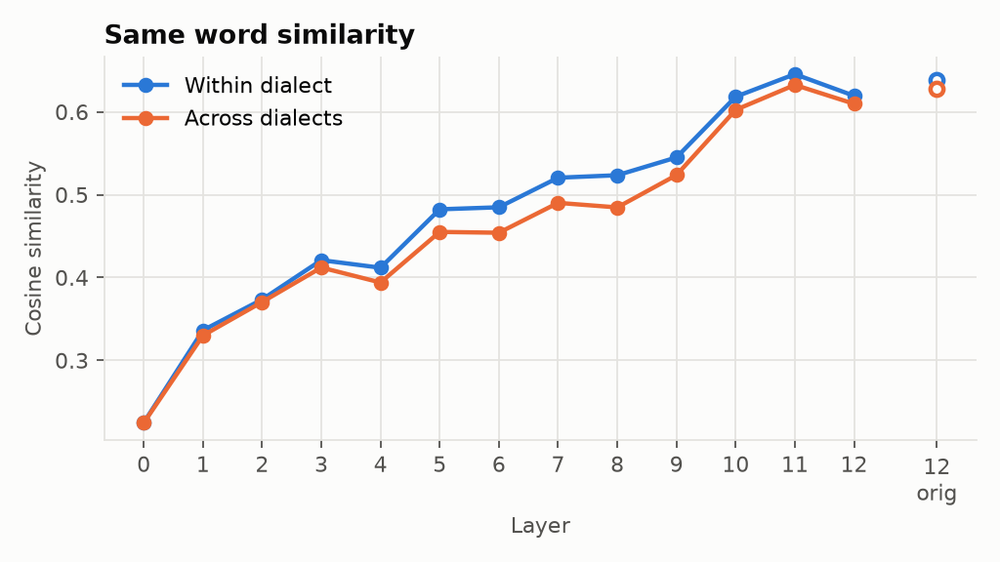
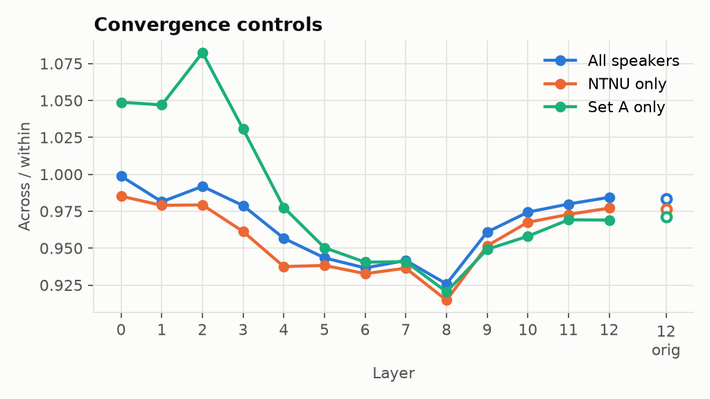
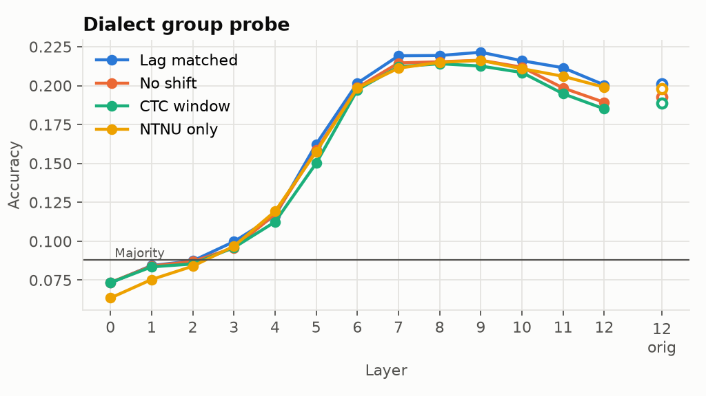
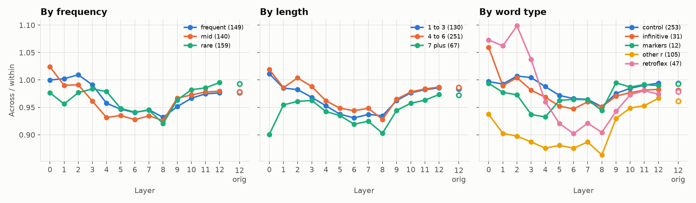
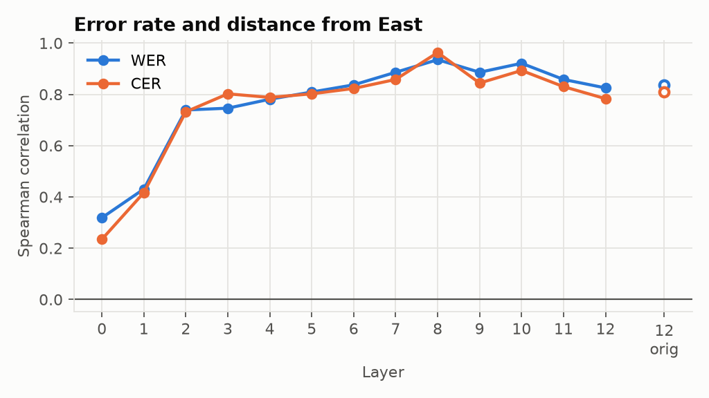
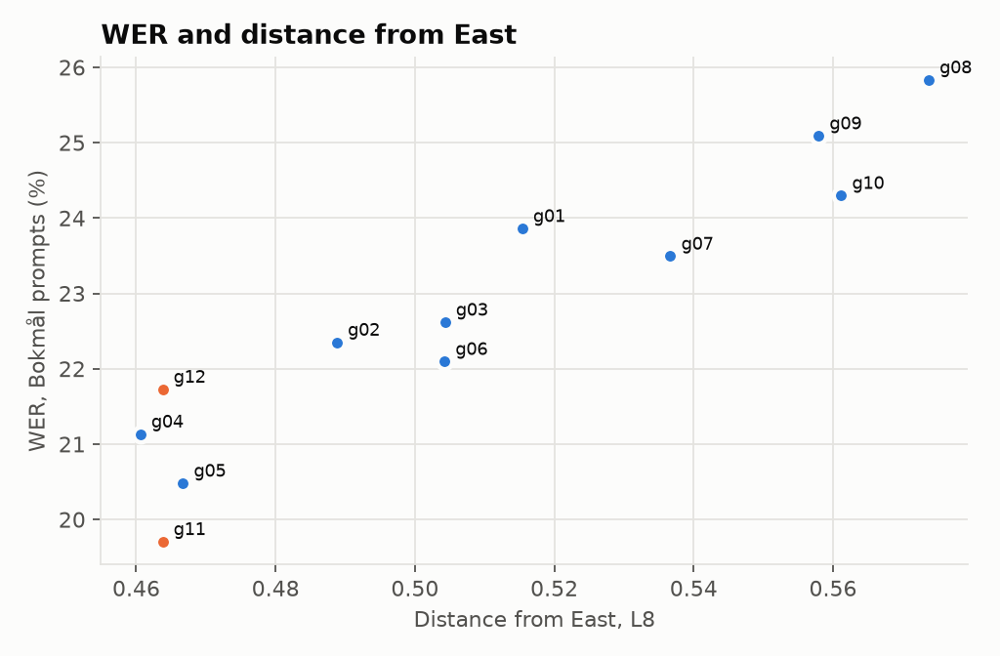
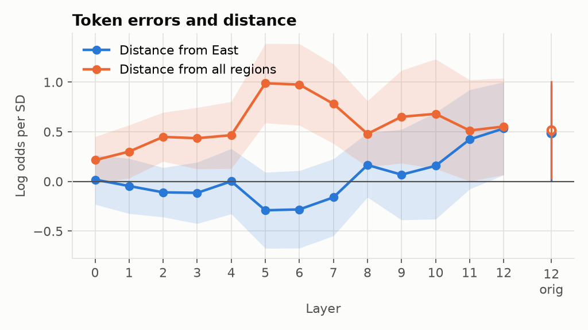
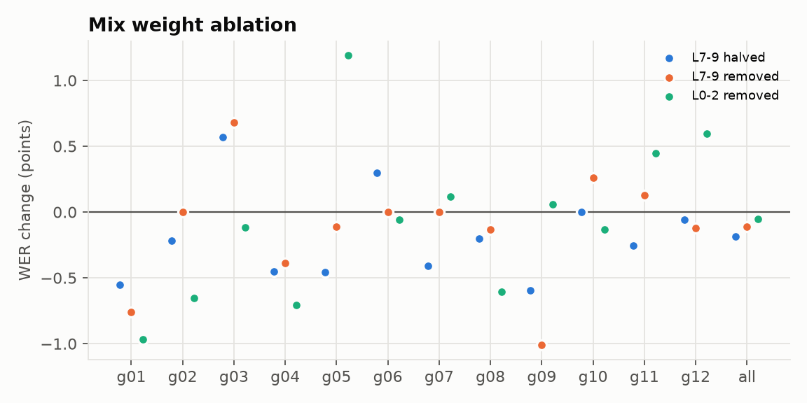

# Step 5 findings

## Conclusion (read speech)

- **Token-level errors come from general atypicality, not distance from East.** A token far from the typical pronunciation of its word is more likely to be misrecognized. Being far from the Eastern pronunciation in particular adds nothing, at least up to L10.
- **The region-level correlation does not hold at token level.** Across the 12 regions, distance from East correlates with Bokmål WER (Spearman 0.94 at L8), but this pattern disappears for individual tokens. It should not be read as evidence that the model is biased toward Eastern speech. Regions with more distinct dialects also have more atypical tokens overall, and regions differ in other ways too.
- **L7-L9 are redundant in the layer mix.** The dialect signal peaks in these layers, but removing them from the mix leaves WER unchanged in every region.
- **The encoder's representations converge across dialects only partly.** The same word is nearly as similar across dialects as within one (across/within ≥ 0.92). Upper layers converge more than middle ones. Fine-tuning L12 changed none of this.
- **Dialect has a small effect on read speech.** Bokmål WER ranges from 19.7% (g11) to 25.8% (g08).

Speakers in groups 1-12 are split in half within each group and gender. The selection half (130
speakers) picks a pooling lag per layer; every number below is from the other half (120 speakers in
groups 1-12, 26,272 word tokens, 448 word types read in at least 3 groups). Same-speaker and
same-sentence pairs are excluded. Main windows are the manual word boundaries shifted by the
selected lag; unshifted manual and shifted CTC windows are robustness checks.

## Lag per layer

The lag is chosen by a word identity probe (118 words, 2 speaker folds), not by any dialect contrast.
It grows with depth: 0 s up to L2, 0.12 s at L5-L7, 0.24 s at L11-L12. Without the shift, word
identity accuracy at L12 falls from 0.95 to 0.68, so layer-matched windows matter.

## Convergence

 

Same-word similarity across dialect groups stays close to similarity within a group at every layer
(across / within ≥ 0.92). The dialect gap is not significant up to L3, grows through the middle
layers, peaks at L8 (ratio 0.926, gap 0.039, speaker-permutation p ≤ 0.01) and shrinks toward the
top (L12 0.984, still p ≤ 0.01). Upper layers partly converge, but they don't fully converge.
The same shape holds with NTNU recordings only, on set A sentences only (identical text for all
speakers), and with unshifted or CTC windows.

| Layer | Within | Across | Ratio | Dialect probe |
|---|---|---|---|---|
| L0 | 0.225 | 0.225 | 0.999 | 0.073 |
| L4 | 0.412 | 0.394 | 0.957 | 0.116 |
| L8 | 0.523 | 0.485 | 0.926 | 0.219 |
| L12 | 0.619 | 0.610 | 0.984 | 0.200 |
| L12 orig | 0.638 | 0.627 | 0.983 | 0.201 |

## Dialect probe

A 12-way linear probe on single word tokens (5 speaker folds) is at or below the majority baseline
(0.088) up to L2. It rises to 0.22 at L7-L9 and drops slightly to 0.20 at L12. It is
not explained by recording place: with NTNU speakers only it reaches 0.216.

## Strata

- **Frequency:** no consistent effect.
- **Length:** words of 7+ letters diverge more at every layer.
- **Words with r but no r+consonant cluster:** these show the largest dialect gap at all layers, including L0 (ratio 0.86-0.94). This fits the tapped vs uvular r split.
- **Retroflex contexts:** close to no gap early, then a clear dip at L5-L8 (0.90).
- **Pronoun and negation markers:** only 12 types; they behave like controls.
- **Infinitive class:** it holds words like *dette*, *bare*, *neste* that are rarely used as infinitives, so it is not a clean test of -a/-e endings.

## Error rate and distance from East

 

Distance from East is 1 minus the mean same-word similarity to groups g11 and g12. Across the 12 groups it tracks
greedy Bokmål WER from L2 upward, strongest at L8 (Spearman 0.94, permutation p < 0.001). Leaving
out g11 and g12 themselves, which are near by construction, it still holds (n = 10, ρ = 0.95 at L8).
g08 (Rogaland and Hordaland) is recorded entirely at NTNU and has both the largest distance and the
highest WER, so recording place does not drive this.

## Original vs fine-tuned layer 12

Fine-tuning only L12 left it nearly unchanged on every measure:

| Measure | Fine-tuned | Original |
|---|---|---|
| Selected lag | 0.24 s | 0.24 s |
| Word probe | 0.949 | 0.949 |
| Across / within ratio | 0.984 | 0.983 |
| Dialect probe | 0.200 | 0.201 |
| WER correlation (ρ) | 0.83 | 0.84 |

The partial convergence at the top is already in Google's encoder. Fine-tuning did not add it.

## Word-level errors (5f)

**Setup:**
- Tokens: analysis half, Bokmål prompts. A token counts as an error if it is not matched in the greedy transcript.
- Each token gets two distances:
  - from the Eastern (g11, g12) centroid of its word type;
  - from the centroid of its word type over all regions.
- Both centroids leave out the token's own speaker.
- The Eastern centroid needs at least 2 other Eastern speakers.
- Only word types with both correct and wrong tokens are kept: 8,004 tokens, 121 types, token error rate 0.20.
- Model: logistic regression with both distances (standardized), plus word-type and speaker fixed effects. Word type absorbs word length. Standard errors are clustered by speaker.

**Results:**
- Distance from all regions predicts errors at every layer from L1. It is strongest at L5-L6 (+0.99 log odds per SD, p < 1e-5).
- Distance from East adds nothing beyond it in L0-L10. At L8 it is +0.17 (p 0.32).
- Only at L11-L12 does it add a little: +0.53 at L12 (p 0.03; without Eastern speakers +0.47, p 0.09).
- Within word types, error tokens are not further from East than correct tokens once overall distance is regressed out: 57% of 80 types at L8.
- The two distances correlate 0.92-0.98, so the test has limited power to separate them.
- Without the control, distance from East alone does predict errors (+0.62 at L8). That effect is carried by a token being atypical in general.

The region-level link between WER and distance from East is therefore not visible token by token. Within a word type, a token that is far from the East is no more likely to be misrecognized than an equally atypical token in any other direction.

## Layer mix and ablation

| Layer | Mix weight | Dialect probe | Gap |
|---|---|---|---|
| L0 | 0.092 | 0.073 | 0.000 |
| L5 | 0.215 | 0.162 | 0.027 |
| L6 | 0.166 | 0.202 | 0.031 |
| L7 | 0.085 | 0.219 | 0.030 |
| L8 | 0.042 | 0.219 | 0.039 |
| L9 | 0.043 | 0.221 | 0.021 |
| L12 | 0.147 | 0.200 | 0.010 |

The mix favours L5-L6 and L12. L7-L9, where the dialect signal peaks, together get 0.17 (uniform would be 0.23). L5-L6 carry nearly as much dialect information.

Exploratory ablation:
- Setup: greedy decoding of the analysis half (2,068 utterances) with L7-L9 halved or removed and the rest renormalized. A control removes L0-L2 instead, a similar 0.19 of the weight.
- Overall Bokmål WER: 23.69% baseline, 23.50% with L7-L9 halved, 23.58% removed, 23.64% for the control. There is no cost, and also no gain.
- Per region the changes are all within about ±1 point, about the noise level for roughly 170 utterances per region.
- The changes are not related to distance from East (Spearman 0.06, -0.02, -0.23).
- Removing L7-L9 does not remove the dialect information, because L5-L6 and L12 carry much of the same signal. So this is weak causal evidence either way.

## Caveats

- NB Tale modules 1-2 are read speech. Module 3 (spontaneous speech) is a planned follow-up.
- WER and CER are greedy without a language model, and only Bokmål prompts are used. Nynorsk prompts have about 50% WER for every group, because the model only writes Bokmål.
- 12 groups is a small n for the correlation. Groups g01-g04, g07, g09 and g10 include speakers recorded at UiT or UiA.
- With 100 permutations, p cannot go below 0.01.

## Spontaneous speech: two explanations that failed (module 3 and NPSC)

The West-East gap on NB Tale module 3 (norsk-asr greedy, +8.6 WER points) was tested against two explanations.
**Both failed.**

**1. "The model writes dialect as Bokmål wrongly."** Not supported. Each substitution or deletion was classified with Norsk ordbank, the module 3 dialect annotations and a hand list. 48-49 of 50 random cases checked by hand were classed correctly.

| Error class | Share of the West-East gap |
|---|---|
| Dialect form written in the output (eg, ikkje, kjem …) | **1%** [−2, 4] |
| Dialect-variable word lost (jeg, ikke, vi, hun …), mostly deletions | 10% [5, 15] |
| Name or number | 7% |
| Other content word | 38% [28, 49] |
| Function word | 37% [20, 49] |
| Insertions | 7% |

**Corrected:** the earlier "writing dialect as Bokmål explains ~1%" was too narrow. Only one statement holds: the model almost never *outputs* a dialect form (1%). The word-level ranking below shows two dialect-related mechanisms that this taxonomy missed:
- **Short dialect forms of common words are dropped.** Examples: e/eg/æ for "jeg", e for "er", de for "det", no for "nå". Including the words the hand list missed, these carry about 28% of the gap (a rough bound from word lists).
- **The references keep non-standard spellings and the model writes standard Bokmål.** Examples: sjøl, heilt, òg, ifra. A sample list of these carries about 10% of the gap.

Even so, accepting spelling variants or dropping function words leaves the gap nearly unchanged (see "Final numbers"). `10a_error_taxonomy.py`, `results/taxonomy_gap.csv`.

**2. "Speakers the model trained on get lower WER."** Not supported, tested on NPSC.
- **Exposure measured:** norsk-asr's 1,337 h of Stortinget training segments were attributed to speakers through clock times in the official referat. 99.4% got a speaker, and a text check confirmed 97.5% of those. NPSC train speakers were added.
- **Overlap:** all 119 named NPSC test/eval speakers occur in training, with a median of 4.1 h each. No test/eval meeting day is in training.
- **Exposure doesn't predict WER:** Spearman −0.01 (101 speakers with ≥ 20 sentences). The slope on log training hours is −0.001 [−0.017, +0.016], with dialect area in the model.
- `10b_train_index.py`, `10c_speaker_exposure.py`, `results/speaker_exposure.csv`.

So neither dialect spellings in the output nor familiarity with the speaker explains the spontaneous-speech gap.

## The module 3 gap is robust to recording conditions, speakers and speech rate

The West-East WER gap on spontaneous speech (norsk-asr greedy, +8.6 points [+5.0, +12.2]) holds in every split tried.

| Check | West - East (points) |
|---|---|
| NTNU recordings only (77 West vs 40 East speakers) | +8.2 [+4.6, +11.8] |
| Shure room microphone instead of the Sennheiser headset (same sessions) | +8.4 [+4.9, +11.9] |
| Female / male | +6.0 [+1.1, +10.6] / +11.5 [+6.0, +17.0] |
| Age 16-39 / 40+ | +7.8 / +8.9 |
| Speech rate added to a mixed model with speaker random effect | West coefficient unchanged (0.370 → 0.369) |

**The gap is robust to recording site, microphone, gender, age and speech rate.**
- Articulation rate is the same in West and East (4.81 vs 4.80 syllables per second), as is pause share (31%). Faster speech does raise errors, but it explains none of the gap.
- ~~In the encoder, spontaneous speech converges a little less at the top layers.~~ **Withdrawn.** That result included misrecognised words, whose forced CTC windows are unreliable on spontaneous speech (mean alignment log-prob −1.46 vs −0.17 for correct words).
  - Split by recognition outcome, correctly recognised spontaneous words converge like read speech: L8 ratio 0.952 vs 0.942, fully converged at L12 (1.005). Western words are not pushed further from Eastern ones (L8: +0.042 spontaneous vs +0.052 read).
  - The extra dialect clustering comes only from the misrecognised words, it is not specific to West vs East, and with such poor windows it may be noise.
  - So the encoder analysis gives no evidence that the spontaneous gap is "in hearing". `11d_encoder_by_correctness.py`, `results/encoder_by_correctness.csv`.

Scripts: `11a_confounds_rate.py`, `11b_microphone.py`, `11c_encoder_spont.py`. Tables: `results/m3_speakers_rate.csv`,
`results/m3_microphone.csv`, `results/encoder_read_vs_spont.csv`.

## Which words make up the gap (module 3, greedy)

Here each reference word type's share of the West-East gap is computed directly, with no predefined classes.
`11e_word_ranking.py`, `results/word_ranking.csv`.
- **The gap is fairly concentrated.** The top 10 word types explain 39% of it, the top 50 explain 73%.
- **Top words:** jeg, er, det, ja, som, så, der, en, nå, sjøl, ei, òg, heilt. Mostly short function words, and mostly deletions (e.g. "jeg" deleted 157 times for West speakers).
- **Same words, worse recognition:** 74% of the gap comes from West speakers getting more errors on the same words. Only 26% comes from using error-prone words more often.
- **Shared vocabulary:** on the 247 word types both areas use at least 5 times, the gap is still +7.4 points.

## Final numbers (module 3, greedy, 95% CI over speakers)

| Scoring | West | East | Gap (points) |
|---|---|---|---|
| WER as reported | 37.1% | 28.5% | +8.6 [+5.0, +12.2] |
| WER, official spelling variants accepted (sjøl = selv, heilt = helt, òg = også …) | 36.3% | 28.0% | **+8.3** [+4.6, +11.9] |
| Content words only (substitutions + deletions) | 38.7% | 30.4% | **+8.3** [+4.3, +12.2] |
| Function words and fillers only | 32.0% | 24.2% | +7.8 [+4.0, +11.5] |

How variants are accepted:
- A substitution counts as correct when the reference and output forms share a Norsk ordbank lemma and tag.
- A short documented list adds Nynorsk and radical forms (heilt, sjøl, òg …).
- This accepts 181 West and 52 East substitutions. A few accepted pairs are doubtful (liker = like, 11 cases).

**The West-East gap is about the same for content words as for function words.** Removing spelling differences
changes it by 0.3 points. **The gap is general recognition difficulty, not spelling or a few
function words.** `11f_final_numbers.py`.

## Confidence flagging and decoding fixes (module 3)

Speakers are split 50/50 within each area. Settings and thresholds are chosen on one half, and numbers are
reported on the other half (125 speakers), with 95% CIs over speakers.

**Confidence flagging works equally well for West and East.** Word confidence is the lowest CTC posterior in
the word. Flagging the lowest 20% of words catches about 50% of misrecognised words in both areas (greedy:
West 50%, East 50%; AUROC 0.80 vs 0.81). Deleted words sit in stretches where the model hears speech but
writes nothing. Flagging the top 20% of those stretches catches about 45% of deletions in both areas. No
West-East difference is significant. `12b_confidence.py`, `confidence_areas.csv`, `confidence_west_east.csv`.

**Retuned decoding cuts WER by about 7 points and removes most of the deletion gap.** The shipped LM settings
(α 0.6, β 1) were tuned on read and parliament speech. On spontaneous speech they raise deletions from 11.4% to 18.7%.

| Decoding (test half) | WER | West | East | Gap | Deletion gap |
|---|---|---|---|---|---|
| Greedy | 34.8 | 37.1 | 29.6 | +7.5 [+2.6, +12.5] | +2.0 [−0.2, +4.2] |
| LM as shipped (α 0.6, β 1) | 33.3 | 35.1 | 28.0 | +7.1 [+1.6, +12.5] | +3.9 [−0.2, +7.7] |
| LM retuned (α 0.4, β 2) + blank penalty 1.0 | **27.1** | 28.4 | 23.4 | +5.0 [+0.5, +9.3] | +0.8 [−0.8, +2.3] |

The gap shrinks by 2.6 points [−4.0, −1.1] compared with greedy on the same speakers. West is still about 21%
worse than East (26% with greedy). **The remaining gap is mainly substitutions:** +4.3 [+1.2, +7.3] of the
+5.0 points (deletions +0.8, insertions −0.2).

A conversational 4-gram LM did not help. It was built from NB Samtale and NPSC train (1.0M words, with no NB
Tale text) and mixed with the shipped LM at decoding time. On the tune half, WER rose as its weight went up.
`12c_conv_lm.py`, `12d_decoding_fixes.py`, `decoding_fixes.csv`.

## LLM correction of transcripts (module 3)

An off-the-shelf Norwegian LLM (Borealis 2 26B-A4B preview, Q3_K_M, the largest that fits in 16 GB) corrects
the test-half transcripts, with temperature 0 and the speaker's previous segment as context. In variant (a) it
may rewrite the whole segment. In variant (b) it may only change words flagged as low-confidence (bottom 20%)
and fill flagged deletion stretches; any other edit is dropped in code. An output is rejected (the ASR text is
kept) when its length is outside 0.5–1.5× the input + 3 words, or when a segment of 5 words or fewer gains
more than 3 words. Rejections count as attempted inventions. 61 of 2,471 calls failed (malformed JSON) and keep
the ASR text. Scoring accepts official spelling variants; plain WER gives the same picture.

| Input, variant | WER before | WER after | Change | Words broken | Invented words | Rejected (attempted inventions) |
|---|---|---|---|---|---|---|
| Greedy, (a) rewrite | 34.1 | 30.0 | **−4.1** [−4.5, −3.8] | 0.7 | 0.3 | 28 of 618 |
| Greedy, (b) flagged only | 34.1 | 33.1 | −0.9 [−1.3, −0.5] | 0.4 | 0.9 | 43 of 618 |
| Retuned LM, (a) rewrite | 26.1 | **25.2** | −0.9 [−1.1, −0.7] | 0.5 | 0.1 | 15 of 618 |
| Retuned LM, (b) flagged only | 26.1 | 26.7 | +0.6 [+0.3, +1.0] | 0.5 | 0.7 | 21 of 617 |

Broken and invented words are per 100 reference words. Invented words are new words aligned as insertions
against the reference.

**The LLM fixes errors without inventing much, but most of what it fixes the retuned LM already fixes.** On
greedy output, rewriting cuts WER by 4.1 points. On retuned LM output it cuts 0.9 points. Invented words stay
at or below 0.3 per 100 words in variant (a). **Restricting edits to flagged spots does worse than free
rewriting.** The model wants to change unflagged words too (820 dropped edits in 370 greedy segments), and
filling gaps adds more inventions than it recovers.

**The LLM does not change the relative West-East gap.**

| Input, variant | Gap before | Gap after | Change [paired CI] | West/East before → after |
|---|---|---|---|---|
| Greedy, (a) | +7.2 | +6.1 | −1.0 [−2.0, −0.04] | 1.25 → 1.24 |
| Greedy, (b) | +7.2 | +6.1 | −1.0 [−2.4, +0.1] | 1.25 → 1.21 |
| Retuned LM, (a) | +4.4 | +3.7 | −0.6 [−1.2, +0.0] | 1.19 → 1.17 |
| Retuned LM, (b) | +4.4 | +4.2 | −0.1 [−1.3, +0.6] | 1.19 → 1.18 |

West gains slightly more points because it has more errors to fix (greedy (a): West −4.6, East −3.6). The ratio
does not move.

West has more rejected rewrites with greedy (a): 14 of 199 calls (7.0%) vs 3 of 104 for East (2.9%), odds ratio
2.5, Fisher exact p = 0.19 (two-sided). This is only a hint that the LLM attempts more inventions on Western
transcripts. The test counts calls, not speakers, and the other three settings show no clear pattern.

**Post-hoc fixes lower WER for all areas but leave the relative West-East gap roughly unchanged.** Retuned
decoding and LLM correction each help every area. The best pipeline (retuned LM, then LLM rewrite) reaches
25.2% WER, and West is still +3.7 points (about 17%) worse than East, compared with 25% with greedy decoding.
`13a_llm_inputs.py`, `13b_llm_correct.py`, `13c_llm_analysis.py`, `llm_correction.csv`, `llm_correction_gap.csv`.

## Weight-space reading and hand edits (module 3, greedy)

After [weight-space programming](https://rikiyat.github.io/blog/weight-space-programming/): read what the
fine-tune changed in L12, then edit weights by hand (no gradients) and keep an edit only if it helps on the tune
half. Each decode of a half takes about 8 s on an H100.

**The L12 fine-tune barely matters for spontaneous speech.** Swapping Google's L12 back in costs 0.7 points on
the tune half and 0.2 on the test half, although the reader was trained on top of the fine-tuned layer. No part
of L12 moves the gap when reverted alone (every change CI spans zero), and scaling the whole change from 0.25×
to 1.5× is flat. Only 2× hurts (+3 points).

| L12 (test half) | WER | West | East | Gap | Gap change |
|---|---|---|---|---|---|
| Fine-tuned | 34.8 | 37.0 | 29.7 | +7.2 [+2.3, +12.4] | |
| Original (Google) | 35.0 | 37.4 | 29.9 | +7.5 | +0.3 [−0.9, +1.2] |

So the Norwegian ability and the gap live in the reader, the layer mix and the head, which were trained from
scratch. This extends the read-speech result above (fine-tuning L12 changed no probe) to WER.

**The change is spread out, except in the relative position projection.** Most matrices change by about 6% with
an effective rank in the hundreds. The relative position projection is nearly rank one: 61% of its learned
change is one component, a smooth ramp from the nearest to the farthest frame (0.5 s back), mostly in heads 0, 4
and 7. Reverting it alone changes nothing (gap change [−0.5, +0.1]).

**The change is not tuned to dialect.** The West-East direction of L12's input (word-centred speaker means,
analysis half) excites the change no more than directions from shuffled speaker labels (ratio 0.74–1.15, all
p > 0.13). Google's weights look the same.

**Hand edits do not close the gap** (tune half, base gap +9.6):

| Edit | West | East | Gap change |
|---|---|---|---|
| Erase the West-East direction from the reader input, k = 1 | 36.8 | 27.7 | −0.5 [−1.1, +0.2] |
| Erase k = 3 / k = 5 | 38.3 / 38.7 | 28.8 / 29.6 | −0.2 / −0.5, CIs span zero |
| Erase directions from shuffled labels, k = 1–5 | | | −0.3 to +1.2 |
| Bias on '▁j' +2 | 37.3 | 27.6 | +0.1 (deletions become substitutions) |
| Move 50% of the L12 mix weight to L5-L6 | 39.1 | 28.6 | +0.9 [−0.2, +1.9] |

**Why West loses "jeg".** The largest single excess is deleted "jeg" (West 7.3 per 1000 words, East 3.2). At those
spots the head does hear speech (median top non-blank probability 0.90), but the top piece is "e" without a word
boundary, glued onto a neighbouring word: West "eg"/"e" is written as part of another word. A bias on '▁j' cannot
fix this. Recovering half the deleted cases needs +2, which fires on 0.4% of all other frames. The excess is a
long tail: the top 40 word pairs explain 32% of it.

The West gap is not one removable obstacle, matching the blog's own finding that edits remove obstacles but do
not add abilities. `14a_l12_revert.py`, `14b_l12_delta.py`, `14c_hand_edits.py`, `14d_jeg_windows.py`,
`l12_revert.csv`, `l12_delta.csv`, `l12_delta_alignment.csv`, `hand_edits.csv`, `word_pair_excess.csv`, `jeg_windows.csv`.

## The model writes like a parliament transcript (module 3, greedy)

Most of norsk-asr's training audio (1,337 of 1,680 h) is Stortinget with edited transcripts. Edited Norwegian
drops spoken-language words, and so does the model.

| Per 1000 words | Stortinget training text | Module 3 references | Ratio |
|---|---|---|---|
| så | 3.8 | 28.6 | 7.6 |
| ja | 0.3 | 5.7 | 21 |
| du | 0.2 | 3.0 | 14 |
| man | 4.6 | 3.1 | 0.7 |
| "ellers så" | 0.001 | 1.0 | about 1300 |
| resumptive "X så VERB" ("i sommer så har jeg") | 0.5 | 7.4 | 14 |

With a blank penalty of 1.0 the most frequent errors (all areas, tune half) are deleted "så" (331) and "og" (272),
ahead of "jeg" (150), and "du" written as "man" (52). Where "så" is deleted the model still hears a word (the top non-blank piece is usually "å" with no word
start), but the reader's state there is a generic "write nothing" state: the kept-minus-deleted difference
lowers the blank and raises every other piece alike.

**Across words, training under-exposure predicts errors.** For the 203 word types with at least 20 tune-half
tokens, the log ratio of module 3 to training frequency predicts the deletion rate (Spearman +0.22, p = 0.002) and
the substitution rate (+0.42, p < 10⁻⁹). In a regression weighted by tokens, with word length and frequency
controlled, each log unit adds 5.7 points of deletions. The top under-exposed words are spoken a-forms
("flytta", "jobba", "anna"), substituted 69–75% of the time (as "flyttet", "jobbet", "annet").

This is a style effect, not dialect: West has about a third of all så and og deletions, close to its share of
words. It does say where the remaining errors come from: the training transcripts, not the audio.
`14e_train_conventions.py`, `train_conventions.csv`, `word_underexposure.csv`.

## Edit loop: read, write an edit, keep it if it helps (module 3, greedy)

`15_edit_loop.py` keeps a stack of hand-written edits (`edits/*.py`, each with its reasoning). `read` profiles the
current stack's errors, `probe` force-aligns one word and reports what the head emits where it is kept or deleted,
and `try` scores a candidate on top of the stack. The target is the mean WER over the five areas on the tune half.
An edit is accepted only if that drops by at least 0.1 points and West does not get worse. The test half is left
for `final`, once, at the end. Every pass is logged in `outputs/edit_loop/log.jsonl`.

| Edit | Reasoning | Mean WER change | West | East | Result |
|---|---|---|---|---|---|
| 01 blank logit −1.0 | deletions outnumber insertions 4:1 | −1.65 | −1.14 | −1.94 | accepted |
| 02 all word starts +0.5 | deleted words come out without a word start | +0.26 | +0.37 | +0.17 | rejected |
| 03 cut 6 suppression units | see below | −0.01 | −0.08 | −0.03 | rejected |
| 04 flip 19 suppression units | see below | −0.09 | −0.12 | −0.25 | rejected (just under 0.1) |

Edit 01 is the blank penalty from `12d`, written into the head. It widens the tune-half gap by 0.8 points
(CI [−0.2, +1.9]).

**Spoken "så" and "og" are dropped late in the reader by a handful of units.** Applying the head after each reader
block (logit lens), kept and deleted tokens look alike up to block 2 and split from block 3 on. At the last block a
deleted "og" has 0.53 non-blank probability in its window against 0.97 for a kept one ("så": 0.80 vs 0.96).
Deleted "jeg" does not split (0.98 vs 0.99): it is written as something else, not suppressed. The extra push
toward blank comes from local branches (block 5 convolution, block 4 feed-forward), not attention.

In block 4 a few feed-forward units push toward blank at deleted "så"/"og" and almost nowhere else. Cutting six of
them (edit 03) lowers så/og deletions from 612 to 589. Flipping the 19 units with that profile (edit 04) lowers
them to 511, a 17% cut: 67 deleted tokens come back as the right word, and only 11 kept tokens become deleted.
The units are specific: deletions of "ja", "jo", "da" fall 5%, "er" and "det" 7%, and "jeg" not at all (145 to 150). Selecting
over 14 function words at once finds mostly the same units. The effect is real but small in WER, because så/og
deletions are about 5% of all errors (612 of about 11,200 on the tune half).

This matches the blog's limit from the other side. A learned convention can be located and partly switched off by
hand, but it is spread across many units, and no single readable edit removes it.
`15_edit_loop.py`, `15b_reader_lens.py`, `15c_reader_branches.py`, `15d_suppression_units.py`, `15e_edit_effect.py`,
`edits/`, `reader_lens.csv`, `reader_branches.csv`, `suppression_units_*.csv`, `edit_effect_*.csv`.
